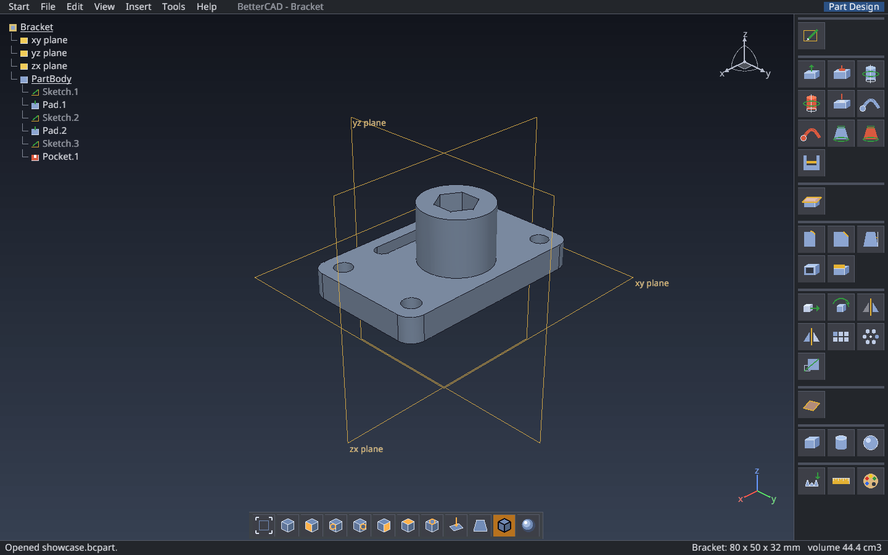
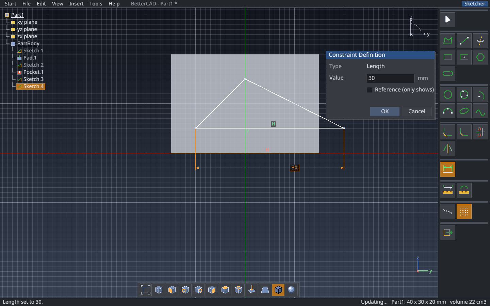

# BetterCAD

**A free, open-source part and assembly modeller with a classic CAD workflow.**

If you have used CATIA V5, BetterCAD will feel familiar: a specification tree on the left, workbench toolbars on the right, a constraint-driven Sketcher, and features like Pad, Pocket, Shaft and Edge Fillet that stay editable. It is written in Rust and builds to a single binary.



---

## Features

### Sketcher
- **Drawing tools:** Profile, Line, Axis, Rectangle, Centered Rectangle, Hexagon/Polygon, Elongated Hole, Circle, Three Point Circle, Arc, Three Point Arc, Ellipse, Spline.
- **Editing:** Corner (fillet), Chamfer, Quick Trim, Mirror, construction (helper) elements.
- **Constraints that drive the geometry:** lengths, distances, radii, diameters and angles, plus automatic horizontal/vertical constraints. Double-click a dimension to change it. Fully constrained elements turn green.
- **Smart snapping:** every point of what you draw or drag snaps, not just the cursor. Points snap onto end, middle and centre points, intersections and curves, and line up with other elements, with dashed alignment guides. Grid snapping toggles with **G**.
- **References to earlier sketches:** earlier sketches show faintly while you sketch. You can snap to them, measure them, and constrain to them. A picked edge becomes a locked yellow reference that updates when its source sketch changes.
- **Measure Between / Measure Item:** distances, angles, lengths, radii and areas.



### Part Design
| Group | Features |
|---|---|
| Sketch-based | Pad, Pocket, Shaft, Groove, Hole (simple / counterbored / countersunk), Rib, Slot, Multi-sections Solid (added and removed), Stiffener |
| Dress-up | Edge Fillet, Chamfer, Draft Angle, Shell, Thickness |
| Transformation | Translation, Rotation, Symmetry, Mirror, Rectangular Pattern, Circular Pattern, Scaling |
| Other | Split, offset Planes, Box / Cylinder / Sphere primitives, mesh import, Measure |

Every feature stays editable: double-click it in the tree. Rebuilds run in the background.

### Assembly Design
- Build products from new parts, saved parts (`.bcpart`) or STL/OBJ meshes.
- Move parts with the Manipulation gizmo (hold Ctrl to snap to 1 mm / 15°).
- Contact, Offset, Coincidence and Angle constraints. Fix a component to anchor it.

### Look and files
- Technical shading with edges, or **realistic rendering** (press **R**) with plastic, 3D-print, metal and wood finishes.
- Native formats `.bcpart` / `.bcasm` keep the full feature history.
- Export **STL** (for 3D printing, in millimetres) and **OBJ** (for game engines); import STL/OBJ.
- Number fields accept maths and units: `20*3`, `1.5in`, `2cm`.
- Adjustable interface size (Ctrl + / Ctrl −, e.g. 200 % on a 4K monitor).

---

## Getting started

You need a recent stable Rust toolchain ([rustup.rs](https://rustup.rs)).

```bash
git clone https://github.com/prinzhoefte/better-cad.git
```

```bash
cd better-cad
```

```bash
CARGO_BUILD_RUSTC=rustc CARGO_TARGET_X86_64_UNKNOWN_LINUX_GNU_LINKER=cc cargo run --release
```

> **Why the environment variables?** `.cargo/config` points cargo at small wrapper scripts in `tools/` that make the build work on NixOS. Those scripts are not in the repository, so on other systems you override them as shown. On NixOS with the wrappers in place, a plain `cargo run --release` works.

On Debian/Ubuntu, the window needs the usual X11/OpenGL libraries:

```bash
sudo apt install libx11-dev libxi-dev libgl1-mesa-dev
```

BetterCAD uses [macroquad](https://github.com/not-fl3/macroquad), which also runs on Windows and macOS, but only Linux is tested so far.

### Command line

| Usage | What it does |
|---|---|
| `bettercad part.bcpart` | Open a part, assembly (`.bcasm`) or mesh (`.stl`, `.obj`) |
| `bettercad --scale 150` | Start with the interface at 150 % |
| `bettercad --screenshot out.png` | Render a few frames, save a screenshot, quit |
| `bettercad --self-test results.json` | Run the scripted end-to-end UI test and write the results |

---

## Controls

| Mouse | Action |
|---|---|
| Middle drag | Pan |
| Hold middle + hold left (or right), drag | Rotate |
| Hold middle, click left once, move up/down | Zoom |
| Wheel | Zoom |
| Middle click | Centre the view there |
| Left click / right click | Select / context menu |

| Key | Action |
|---|---|
| Ctrl+Z / Ctrl+Y | Undo / redo |
| Ctrl+N / Ctrl+O / Ctrl+S | New / open / save |
| Del, Esc | Delete, cancel |
| F | Fit all |
| R | Realistic rendering on/off |
| G | Snap to grid on/off (Sketcher) |
| Enter / double-click | Finish a profile or spline |
| F1 | Controls and tips |

### A first part in 30 seconds
1. Click the **xy plane** in the tree, then **Sketch**.
2. Pick **Rectangle**, click two corners, and type exact sizes on the right.
3. **Exit Workbench**, then **Pad**, then **OK**.
4. Click the top face, **Sketch** again, draw a circle, exit, then **Pocket**.

---

## Development

```bash
CARGO_BUILD_RUSTC=rustc CARGO_TARGET_X86_64_UNKNOWN_LINUX_GNU_LINKER=cc cargo test
```

The unit tests cover geometry, the sketch solver and features. The `--self-test` run drives the real interface like a user would: it clicks toolbar buttons, draws, dimensions, pads, fillets, exports and assembles, then checks the results. On a headless machine, run it under `xvfb-run`.

| File | Contents |
|---|---|
| `src/main.rs` | Window setup, command line, scripted self-test |
| `src/app.rs` | Application state, 3D view interaction, files |
| `src/panels.rs` | Menu bar, toolbars, specification tree, dialogs, icons |
| `src/sketch.rs` | Sketch elements and operations (trim, corner, mirror, regions) |
| `src/sketcher.rs` | Sketcher workbench: tools, snapping, drawing |
| `src/dims.rs` | Sketch dimensions and the constraint solver |
| `src/model.rs` | Parts, assemblies, features and rebuilds |
| `src/geom.rs` | Solid geometry and meshing |
| `src/dressup.rs` | Fillets, chamfers, draft, shell, thickness |
| `src/measure.rs` | Measuring in sketches and in 3D |
| `src/view.rs`, `src/ui.rs` | Camera and the immediate-mode widget kit |

---

## Credits

- [macroquad](https://github.com/not-fl3/macroquad) for windowing and rendering, and [glam](https://github.com/bitshifter/glam-rs) for maths.
- [Noto Sans](https://fonts.google.com/noto/specimen/Noto+Sans), under the SIL Open Font License (`assets/fonts/OFL.txt`).

BetterCAD is not affiliated with Dassault Systèmes. CATIA is a trademark of its owner, mentioned only to describe the workflow.
